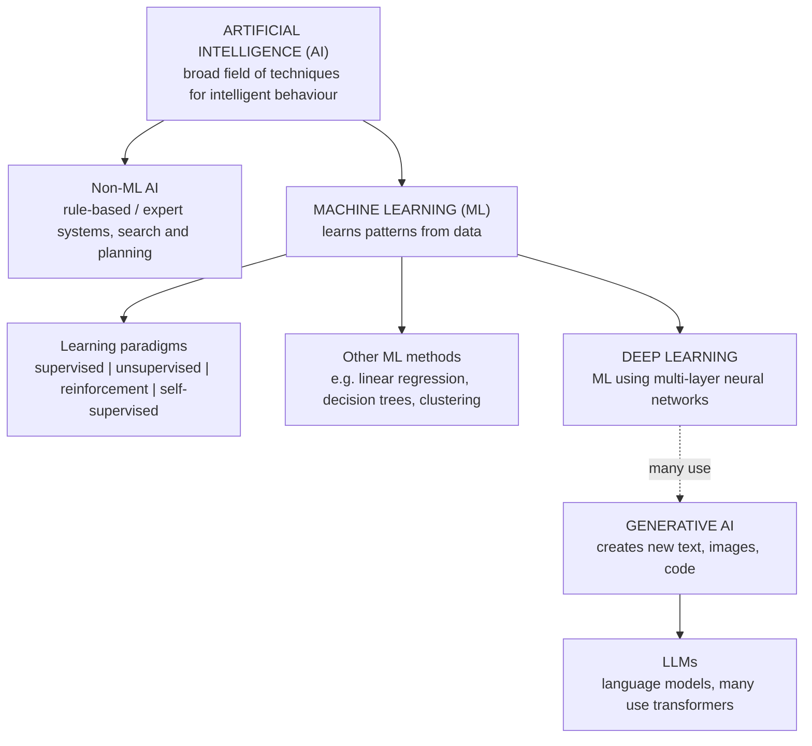

# Mission 1: Build the AI and ML Landscape

**Research question:** What is artificial intelligence, and where exactly does machine learning fit?

## 1. Objective

To understand how AI, rule-based programming, machine learning (ML), deep learning, generative AI and large language models (LLMs) relate to each other, and to avoid treating them as separate technologies at the same level.

## 2. Concept Map

The same map as a diagram that renders directly on GitHub:

**How to read it:** the boxes are at *different levels*. AI is a field, ML is an approach within it, deep learning is a family of ML techniques, generative AI describes what a system *does* (creates content), and an LLM is a *type of model*. Generative AI overlaps with deep learning rather than being a simple child of it, because many (not all) generative systems use deep learning.

## 3. AI vs Rule-Based Programming vs ML

| | Conventional rule-based programming | Machine learning | AI (the broad field) |
|---|---|---|---|
| **What it is** | A developer writes explicit instructions and conditions | A model learns patterns from example data | A field covering any technique that produces intelligent behaviour |
| **What is programmed** | Every decision rule | The learning method and the data pipeline, not each decision rule | Depends on the technique |
| **What is learned from data** | Nothing | The relationship between inputs and outputs | Only if the technique is ML |
| **Example** | A script that flags a log line containing "ERROR" | A model that predicts timing pass/fail from past runs | A search-based chess engine, an expert system, or any ML model |
| **Main limitation** | Hard to write rules for fuzzy or complex patterns | Needs suitable data and can be wrong on unseen cases | Too broad a label to say how a system actually works |

Rule-based programming is **not** a lesser option. For a clear, stable rule, it is usually simpler, cheaper and fully predictable.

## 4. Five Distinctions in My Own Words

1. **AI vs ML.** AI is the big goal and field: making computers do tasks that look intelligent. ML is one way to get there, by letting the computer find patterns in data instead of being told every rule.
2. **Rule-based programming vs ML.** In rule-based programming the *rules* go in and answers come out. In ML, *examples* go in and the computer works out the rules (the pattern) itself, then applies them to new inputs.
3. **ML vs deep learning.** ML includes many methods, from simple ones like linear regression to complex ones. Deep learning is the subset that uses neural networks with many layers.
4. **Deep learning vs generative AI.** Deep learning says *how* a model learns (layered neural networks). Generative AI says *what* the system produces (new content). One describes a technique, the other describes an outcome, so they overlap but are not the same thing.
5. **Generative AI vs LLMs.** Generative AI covers any system that creates content: text, images, audio, code. An LLM is specifically a language model, so LLMs are one kind of generative AI.

## 5. Why Automation Is Not Necessarily AI

Automation means a task runs with little human effort. A script that launches a regression every night is automation: it follows fixed instructions, does not learn from data, and does not make intelligent decisions. Automation becomes AI-related only when the system also uses an AI technique, for example a model that decides *which* tests to run first.

## 6. Why AI Does Not Always Mean ML

Some AI systems do not learn from data at all.
- A **rule-based expert system** applies hand-written "if-then" knowledge.
- A **search-based chess engine** explores possible moves and scores them with a programmed evaluation, which is search and planning, not training on examples.

Both are AI techniques but not ML. This is why AI is the larger set and ML sits inside it. (Modern engines can combine search with learned models, which is why the Non-ML box on the map is about the *technique*, not the whole product.)

## 7. Explicitly Programmed vs Learned from Data

| Explicitly programmed | Learned from data |
|---|---|
| Rules, conditions, thresholds written by the developer | Patterns and relationships found during training |
| Fixed until a human edits the code | Change if the model is retrained on new data |
| Behaviour can be traced to specific lines of code | Behaviour comes from learned parameters, which are harder to inspect |
| Example: an assertion checking `output == expected` | Example: a model that learns which past runs tend to fail |

ML systems still need programming. The code builds the data pipeline, defines the model and runs training. What changes is that part of the *decision behaviour* comes from data instead of hand-written rules.

## 8. Three Examples Classified, with Reasons

| # | Example | Classification | Reason |
|---|---|---|---|
| 1 | A script that runs simulations every night and saves the logs | **Conventional automation** (not AI) | It follows fixed commands and learns nothing from data. |
| 2 | A model trained on historical timing reports to predict pass/fail for a new run | **Supervised ML (classification)** | It learns from examples with known pass/fail outcomes and predicts a category. |
| 3 | A text assistant that writes a plain-English explanation of a Verilog module | **Generative AI using an LLM** | It takes a text prompt and generates new language; such systems typically use deep learning and transformers. |

## 9. What Is Still Unclear (Question Step)

- The boundaries are blurry in practice. Real products often mix rules, search and learned models, so a single label can be too simple.
- "Intelligent behaviour" has no single agreed definition, which is why AI is described as a field rather than one technology.
- I have not yet studied *how* deep learning and transformers work. That comes in later weeks.

## 10. Application to VLSI Design Verification

Conventional automation and rule-based checks (testbenches, assertions, scripted regressions) are the reliable base of verification. ML could possibly *complement* them, for instance by learning from historical simulation results to help prioritise which tests to investigate first. These are illustrative ideas, not claims that a specific commercial tool already does this. An ML prediction should never replace functional checks, assertions or engineering review, and its usefulness must be measured with suitable data and metrics.

## 11. Conclusion

AI is the broad field. ML is an approach inside it that learns patterns from data. Deep learning is a family of ML techniques built on multi-layer neural networks. Generative AI describes systems that create content, and LLMs are language-focused models within that group. Automation can exist without AI, and AI can exist without ML. The right choice depends on the problem, the available data and the cost of being wrong.

## 12. Sources

Full list with the claims each one supports is in [`sources.md`](sources.md) (Mission 1 section).
