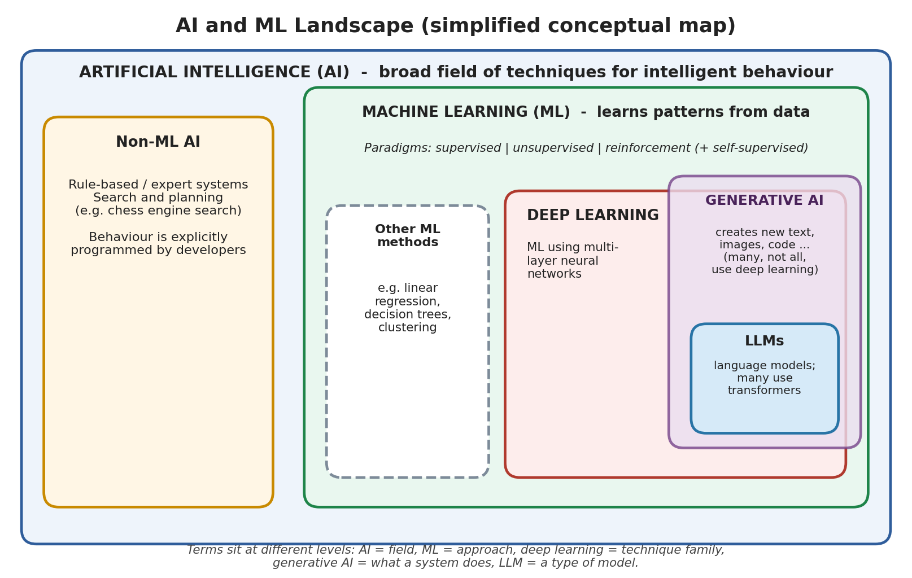

# Mission 1: Build the AI and ML Landscape

**Research question:** What is artificial intelligence, and where exactly does machine learning fit?

---

## 1. Concept Map



Text version of my map:

```
+--------------------------------------------------------------+
| ARTIFICIAL INTELLIGENCE (AI)                                 |
| Machines doing tasks that need intelligent behaviour         |
|                                                              |
|  +--------------------------------------------------------+  |
|  | MACHINE LEARNING (ML)                                  |  |
|  | Learns patterns from data instead of fixed rules       |  |
|  |                                                        |  |
|  |  +--------------------------------------------------+  |  |
|  |  | DEEP LEARNING (DL)                               |  |  |
|  |  | ML using neural networks with many layers        |  |  |
|  |  +--------------------------------------------------+  |  |
|  +--------------------------------------------------------+  |
|                                                              |
|  Rule-based AI (expert systems, hand-written rules)          |
|  -> this is AI but NOT ML                                    |
+--------------------------------------------------------------+

Generative AI = systems that CREATE new content (text, images, code)
LLMs = large language models, a type of generative AI for language,
       mostly built with deep learning (transformers)
```

**Note:** Generative AI and LLMs are not another circle inside the map. Deep learning tells us *how* a model is built, while generative AI tells us *what the system does*. So they are at different levels, and I should not treat them as separate technologies side by side.

---

## 2. Programmed vs Learned

| Explicitly programmed by a human | Learned from data |
|---|---|
| If-else rules | Patterns between inputs and outputs |
| Fixed thresholds | Model parameters (weights) |
| Steps of the script/algorithm | Decision boundaries |
| Choice of model, features and metric | Which input combinations matter |

In normal programming I give the computer the **rules + data** and it gives the answer. In ML I give the computer the **data + answers** and it finds the rules.

---

## 3. AI vs Rule-based Programming vs ML

| | Rule-based programming | Machine learning |
|---|---|---|
| Who creates the logic | The programmer | The model learns it from data |
| What I give it | Rules + input | Examples (data, often with labels) |
| New situations | Fails if no rule exists | Can handle similar unseen cases |
| Data needed | Little or none | Usually a lot |
| Easy to explain? | Yes | Often harder |
| Example | Script that renames files | Spam filter |

---

## 4. Five Distinctions

**1. AI vs ML**
AI is the big field of making machines act intelligently. ML is one approach inside AI where the machine learns from data. So every ML system is AI, but not every AI system is ML.

**2. Rule-based programming vs ML**
In rule-based programming I write the logic myself. In ML I give examples and the system finds the logic. Rules work well when the logic is simple and clear. ML is useful when the logic is too complicated to write by hand but I have enough data.

**3. Automation vs AI**
Automation means a task runs on its own, but it follows the same fixed steps every time. For example, a script that runs my testbench regression every night is automation. It does not learn or decide anything. It would only be AI if it showed some intelligent behaviour, like recognising patterns or adapting.

**4. AI that is not ML**
Early chess programs and expert systems used rules and search written by people. They are AI because they behave intelligently, but they do not learn from data. This shows that AI does not always mean ML.

**5. ML vs deep learning, and generative AI vs LLMs**
Deep learning is a part of ML that uses neural networks with many layers. Generative AI is about creating new content, and LLMs are generative models for language, mostly built using deep learning. They are not all the same kind of thing, because some terms describe how a model is built and some describe what it does.

---

## 5. Three Examples Classified

| Example | Category | Reason |
|---|---|---|
| Script that runs the verification regression every night and sends the log | Automation (not AI) | It repeats fixed steps. It does not learn or make intelligent decisions. |
| Spam filter trained on labelled emails | Machine learning (supervised) | It learned what spam looks like from examples. Nobody wrote the spam rules by hand. |
| Design rule check like "minimum spacing must be X nm" | Rule-based / conventional programming | Humans wrote every rule and the tool only checks them. It does not learn. |

---

## 6. Summary

AI is the broad field. ML is a way of doing AI by learning from data, and deep learning is a type of ML. Generative AI and LLMs describe what some deep learning systems do. The simple question I can ask for any system is: **who wrote the logic, a human or the data?**

---

## 7. Sources

| Source | Link | What it supports |
|---|---|---|
| Google, Introduction to Machine Learning | PASTE LINK HERE | ML learns from data; difference from traditional programming |
| IBM, What is Machine Learning? | PASTE LINK HERE | How AI, ML and deep learning relate |
