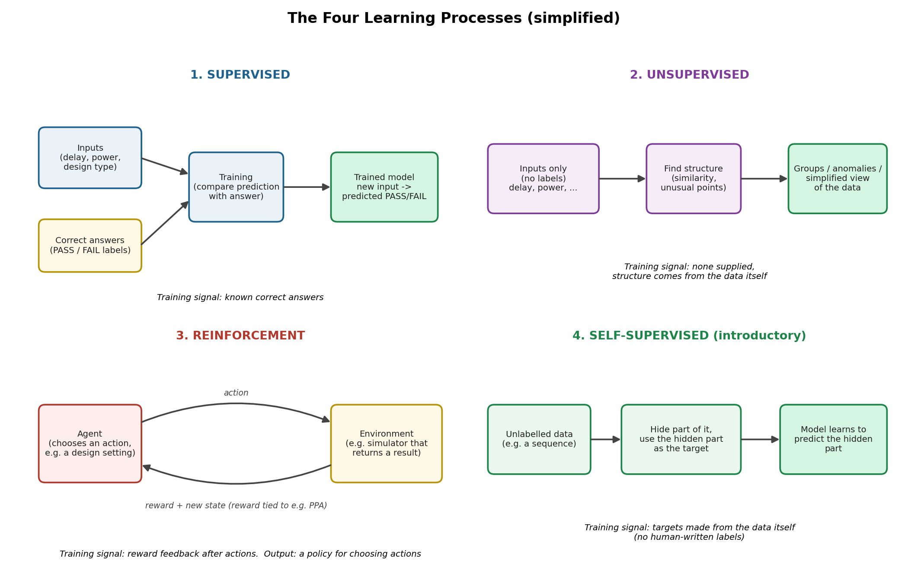
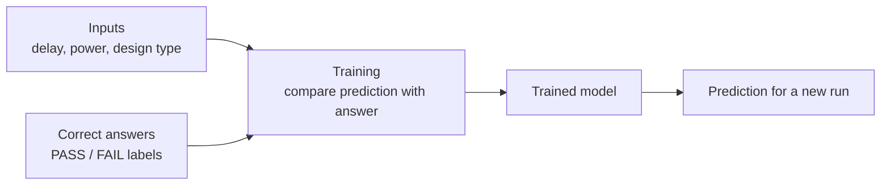
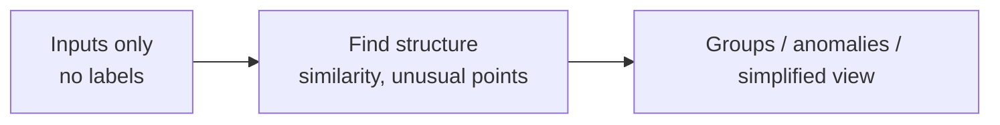
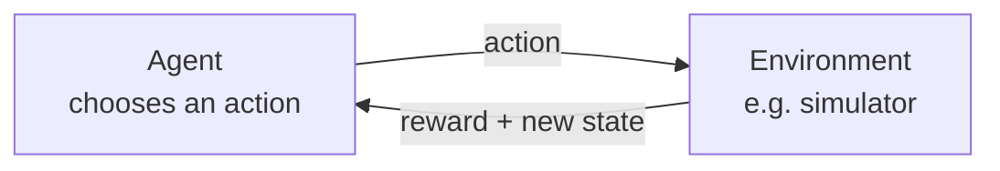
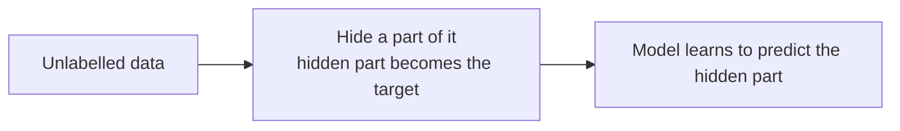

# Mission 3: Understand the Main ML Approaches

**Research question:** How does a system learn when it has labels, no labels, or feedback from actions?

## 1. Objective

To compare supervised, unsupervised and reinforcement learning by looking at the *training signal* each one uses, what it produces and where it is limited, and to recognise self-supervised learning as a related approach where the targets come from the data itself.

**Key idea:** these are broad *learning paradigms*, meaning they describe *how the learning signal is obtained*. They are different from *task types* (classification, regression, clustering and so on), which describe *what the model is asked to output*. Task types are covered in Mission 4.

## 2. Comparison Table

| | Supervised | Unsupervised | Reinforcement | Self-supervised (intro) |
|---|---|---|---|---|
| **Core idea** | Learn from examples paired with the correct answer | Find structure in data with no answers supplied | Learn which actions to take from reward feedback | Create the training targets from the data itself |
| **Training signal** | Known labels / target values | None supplied; structure in the data | Reward received after actions | Part of the input hidden and used as the target |
| **Data needed** | Inputs + labels | Inputs only | An environment to act in and a reward rule | Unlabelled inputs (often a lot) |
| **What it produces** | A model that predicts a label or number for new inputs | Groups, unusual points, or a simplified view of the data | A policy: a way of choosing actions | A model that predicts hidden parts, often reused as a starting point for other tasks |
| **Semiconductor example (illustrative)** | Predict timing PASS/FAIL from past labelled runs | Group similar design runs, or flag an unusual measurement pattern | Explore design settings using a reward tied to PPA objectives | Predict a masked part of a sequence such as a log |
| **One limitation** | Needs labelled data, which can be costly, and wrong labels teach wrong answers | No "correct answer" to check against, so the results need human interpretation | Needs many trial interactions and a well-designed reward; a poor reward can lead to unwanted behaviour | Usually needs a lot of data, and the choice of what to hide strongly affects what is learned |
| **Key question** | What target should the model learn to predict? | What structure is present in the data? | Which actions help achieve the goal? | What training signal can be created from the data? |

All semiconductor examples above are **illustrative ideas**, not claims that a specific tool already does this.

## 3. Diagrams of Each Learning Process

The same flows in text form (these render on GitHub):

**Supervised**

**Unsupervised**

**Reinforcement**

**Self-supervised**

## 4. Each Approach in My Own Words

### Supervised learning
The model is shown many examples where the correct answer is already known, like practice questions with an answer key. It adjusts itself until its predictions match the answers, then tries to give good answers for new inputs. In Mission 2, the table with the `Timing result` column is exactly this kind of data.
- **Produces:** a model that predicts a category (e.g. PASS/FAIL) or a number.
- **Limitation:** it needs labelled data. Labels can be expensive to obtain, and mistakes in the labels get learned too.

### Unsupervised learning
The model gets data but no answers. It has to look for patterns itself, such as which examples are similar or which one looks unusual. If I removed the `Timing result` column from the Mission 2 table, I could still ask which runs look alike.
- **Produces:** groups (clusters), flagged unusual points, or a simplified representation of the data.
- **Limitation:** there is no answer key to check against, so a person has to judge whether the structure found is meaningful.

### Reinforcement learning
There is no table of correct answers. Instead, a learner (the *agent*) tries actions in an *environment* and receives a *reward* signal showing how good the result was. Over many attempts it learns which actions tend to lead to better rewards.
- **Produces:** a policy, meaning a rule for choosing actions.
- **Limitation:** it usually needs a lot of trial and error and a carefully designed reward. If the reward does not really capture the goal, the agent may find unwanted shortcuts.

### Self-supervised learning (introductory)
Here no human writes labels, but the training still has a "right answer". The answer is taken from the data itself. For example, hide a word, or part of a sequence, and train the model to predict what was hidden. The data supplies both the question and the answer.
- **Produces:** a model that has learned useful patterns about the data, which can often be reused for other tasks.
- **Limitation:** it typically needs a large amount of data, and the choice of what to hide shapes what the model learns.

This is kept introductory on purpose. Its link to neural networks and LLMs belongs to later weeks.

## 5. Why Self-Supervised Is Not Simply "Another Name for Unsupervised"

They are closely related, which is why the terms get mixed up, but they are not identical in every context.

- **What they share:** neither needs human-provided labels.
- **Where they differ:** classic unsupervised learning looks for structure *without a specific prediction target* (for example clustering). Self-supervised learning sets up a *specific prediction task* using targets created from the data, so its training looks much more like supervised learning.
- Some sources describe self-supervised learning as technically a subset of unsupervised learning because no labelled dataset is needed, while also noting that most unsupervised learning does not involve self-supervision (see IBM source in `sources.md`). So whether it is "the same" depends on which definition is used, and treating the names as interchangeable can hide the difference in training signal.

## 6. When Each Approach May Be Suitable

| Situation | Suitable approach | Why |
|---|---|---|
| I have past examples *with* known outcomes and want to predict the outcome for new cases | Supervised | The known outcomes provide a clear target |
| I have lots of data but no outcomes, and want to explore it or spot odd cases | Unsupervised | It does not need labels |
| A system makes a sequence of choices and I can score the result of those choices | Reinforcement | Learning comes from reward feedback; it also usually needs a safe environment (like a simulator) to try actions in |
| I have a lot of unlabelled data and want a model to learn its general patterns first | Self-supervised | Targets can be created from the data, avoiding manual labelling |

## 7. Connection to Semiconductor / DV Work

These are illustrative ideas to investigate, not claims about existing tools:
- **Supervised:** historical simulation runs labelled pass/fail could be used to try to predict which new runs are risky.
- **Unsupervised:** similar failure reports could be grouped, or an unusual coverage pattern flagged for an engineer to examine.
- **Reinforcement:** an agent could explore design or tool settings, with a reward linked to power, performance and area (PPA). This is a research-style idea and would need a trustworthy simulator and a carefully designed reward.
- **Self-supervised:** a model could learn patterns from unlabelled log or text data by predicting hidden parts.

In every case, predictions are outputs to evaluate, not automatic truth.

## 8. What Is Still Unclear

- How a model actually "adjusts itself" during training (loss and optimisation). That is Mission 5.
- How semi-supervised learning, where only some data has labels, fits next to these four.
- The details of how self-supervised learning connects to neural networks and LLMs, planned for later weeks.

## 9. Conclusion

The four approaches differ mainly in the *training signal*: supervised uses known answers, unsupervised uses none and looks for structure, reinforcement uses rewards from actions, and self-supervised creates its targets from the data. Choosing among them starts from the problem: what data and feedback are actually available. These paradigms describe *how* learning happens, while task types such as classification or clustering describe *what* the model outputs, and the two should not be mixed up.

## 10. Sources

Full list with the claims each one supports is in [`sources.md`](sources.md) (Mission 3 section).
