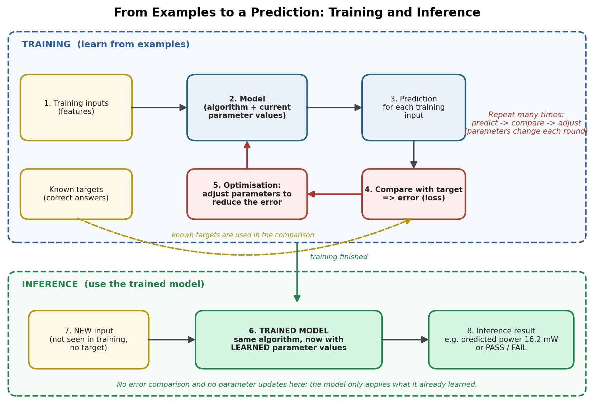
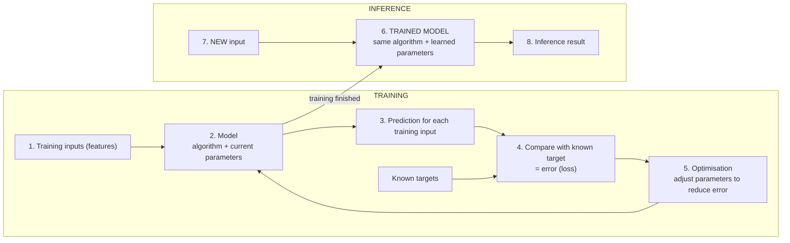
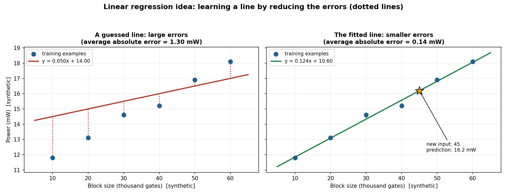

# Mission 5: Understand the Anatomy of an ML Model

**Research question:** What happens between feeding data into an ML system and receiving a prediction?

## 1. Objective

To explain the difference between an algorithm, a model and learned parameters; to separate training from inference; and to understand, without calculus, how a model's outputs are compared with target answers (loss) and improved (optimisation). Linear regression is used as the simple worked example.

## 2. Algorithm vs Model vs Learned Parameters

| Term | Meaning | Linear regression example |
|---|---|---|
| **Algorithm** | The *procedure* used to learn from data | The method that finds the best-fitting straight line through the examples |
| **Model** | The *thing that makes predictions*, produced by training | The line "power = slope x size + intercept" |
| **Parameters** | The numbers inside the model that are *learned from data* | The slope and the intercept |

Easy way to remember: the **algorithm** is the learning recipe, the **parameters** are the values the recipe works out, and the **model** is the finished predictor that uses those values. The same algorithm trained on different data ends up with different parameter values, so it gives a different model.

## 3. Training vs Inference

| | Training | Inference |
|---|---|---|
| **Purpose** | Learn the parameters from examples | Use the trained model on new input |
| **Data used** | Examples with known targets (in supervised learning) | A new input; the true answer is not known |
| **What happens** | Predict, compare with the target, adjust parameters, repeat | Parameters stay fixed; the model just produces a prediction |
| **Output** | A trained model | A prediction (a number, a category and so on) |
| **When** | Done before the model is used (and again if it is retrained) | Every time the model is used |

## 4. Flow Diagram: Examples to Training to Trained Model to Inference

The same flow as a diagram that renders on GitHub:

**Reading the diagram:** steps 2 to 5 form a loop that repeats many times. Each round the model predicts, the prediction is compared with the known target, and the parameters are adjusted to reduce the error. Once training is finished, the parameters are fixed. At inference, a new input goes in and a prediction comes out, with no targets and no adjusting.

## 5. Comparing Outputs with Targets: Loss and Optimisation

**Error and loss.** During training the model's prediction is compared with the target answer. The difference is the *error*. A *loss* (or error measure) combines the errors over all training examples into one number that says how wrong the model currently is. For example, "on average the prediction is off by 1.3 mW". A smaller loss means the predictions are closer to the targets.

**Optimisation.** Optimisation is the process of changing the parameters so that the loss gets smaller. The intuition: it is like adjusting a knob, checking whether the result got better or worse, and repeating, until further adjustments no longer help much. Different methods choose the adjustments in different ways, but the aim is the same: reduce the loss on the training examples.

**Why a loss measure is needed.** Without one number saying "how wrong", the computer would have no way to decide whether one set of parameters is better than another.

(No calculus is needed for this idea this week. How the adjustments are calculated in neural networks is left for later weeks.)

## 6. Linear Regression, Conceptually

**What it does:** it learns a straight-line relationship between an input and a numerical outcome, from example pairs, and then uses that line to estimate the outcome for a new input.

### Worked example (synthetic data)

Suppose I have 6 example blocks, with their size (thousand gates) and measured power (mW). These numbers are made up for illustration.

| Block size (thousand gates) | Power (mW) |
|---:|---:|
| 10 | 11.8 |
| 20 | 13.1 |
| 30 | 14.6 |
| 40 | 15.2 |
| 50 | 16.9 |
| 60 | 18.1 |

- **Input (feature):** block size. **Target:** power.
- **Model form:** power = slope x size + intercept. The slope and intercept are the two parameters.
- **Training:** try a line, measure the errors against the six examples, and adjust the slope and intercept to make the errors smaller.

### Before and after training

| Size | Actual power | Guessed line (0.05x + 14.0) error | Fitted line (0.124x + 10.60) error |
|---:|---:|---:|---:|
| 10 | 11.8 | -2.7 | -0.04 |
| 20 | 13.1 | -1.9 | 0.01 |
| 30 | 14.6 | -0.9 | 0.27 |
| 40 | 15.2 | -0.8 | -0.37 |
| 50 | 16.9 | 0.4 | 0.09 |
| 60 | 18.1 | 1.1 | 0.04 |
| | **Average absolute error** | **1.30 mW** | **0.14 mW** |

(Error = actual minus predicted, in mW. The fitted line was found with a standard least-squares line fit, run on this synthetic data with Python.)

The guessed line has large errors, so its loss is high. The fitted line sits much closer to the examples, so its loss is low. That is what "learning" means here: the parameters moved to values that reduce the error.

### Inference with the trained model

For a **new** block of size **45** (not in the training data), the fitted line predicts about **0.124 x 45 + 10.60 = 16.2 mW**. No target is used at this step.

### Limitations to keep in mind

- A straight line assumes the relationship is roughly linear. Real power may not grow in a straight line with size.
- Predictions far outside the range of the training examples (for example size 500) are not trustworthy, because the model never saw such cases.
- Six synthetic points are far too few for a real model, and a small training error does not by itself prove the model works on new data. That is the focus of Mission 6.

## 7. Different ML Methods Learn in Different Ways

The loop above (predict, compare, adjust) is a useful general picture, especially for supervised learning, but it is simplified:
- A **decision tree** learns by choosing questions that split the data.
- **Clustering** methods group samples without any target to compare against.
- **Neural networks** adjust many parameters (called weights) using gradient-based methods, covered in later weeks.

So "parameters" and "loss" mean somewhat different things in different methods. Linear regression is just one of the simplest examples.

## 8. Connection to Semiconductor Work

An illustrative idea: a regression model could learn from past design blocks to estimate power or delay from early design features, so that engineers get a quick rough estimate before running the full analysis. The estimate would need checking against the real analysis results, since a model's prediction is an output to evaluate, not a final truth. This is an idea to investigate, not a claim about an existing tool.

## 9. What Is Still Unclear

- How the optimiser actually decides *how much* to change each parameter (gradient-based learning, later weeks).
- How to choose a suitable loss measure for different problems.
- How to know when to stop training. This links to overfitting in Mission 6.

## 10. Conclusion

An algorithm is the learning procedure, parameters are the values it learns, and the model is the predictor that results. Training repeats a loop of predicting, comparing with targets to get a loss, and adjusting parameters to reduce it. Inference then uses the fixed, trained model on new inputs. Linear regression shows the whole idea in a simple form: learn a line from examples and use it to estimate an outcome for a new input.

## 11. Sources

Full list with the claims each one supports is in [`sources.md`](sources.md) (Mission 5 section).
