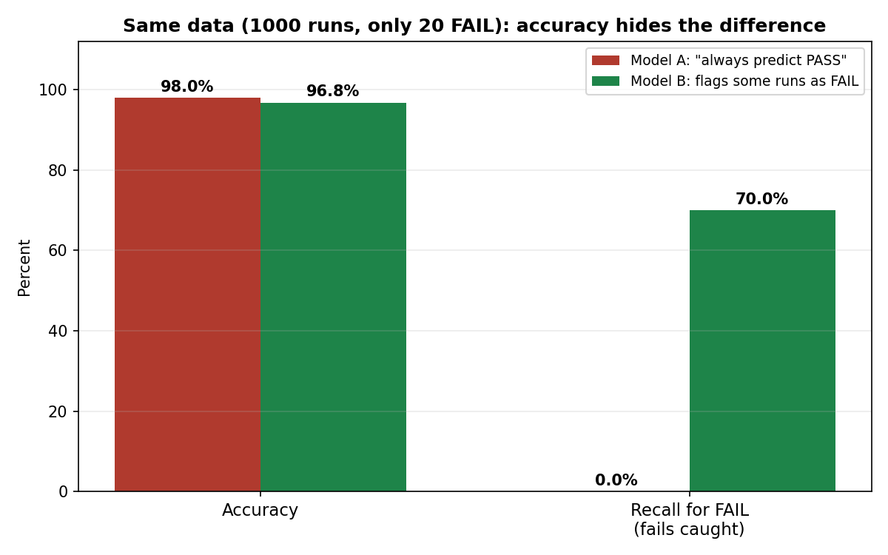

# Mission 6: Understand Evaluation and Generalisation

**Research question:** How do we know whether a model has learned something useful?

## 1. Objective

To explain the roles of training, validation and test data; to define generalisation, overfitting and underfitting; to understand common metrics at a conceptual level; and to show with a worked example how accuracy can mislead when classes are imbalanced.

All numbers in the examples below are **synthetic** and made up for illustration.

## 2. Training, Validation and Test Sets

The available data is split into parts so the model is judged on examples it did **not** learn from.

| Set | Role | Analogy |
|---|---|---|
| **Training set** | The model learns its parameters from these examples | Practice questions the student studies |
| **Validation set** | Used during development to compare models or settings and to spot overfitting | A mock exam used to decide how to improve |
| **Test set** | Used at the end, once, to get a fair estimate of performance on new data | The final exam |

Why not just check on the training data? A model can score well on examples it has already seen simply by remembering them. Only unseen data shows whether it learned something that carries over.

Two cautions:
- The test set should not be used to repeatedly tweak the model. If it is, it stops being a fair final check.
- How the data is split matters. If related items (such as samples from the same wafer or the same design) land on both sides, information leaks and the test score looks better than it really is (see Mission 7).

## 3. Generalisation, Overfitting and Underfitting

- **Generalisation:** how well a model performs on **new, unseen** data. This is what we actually care about.
- **Overfitting:** the model fits the training data too closely, including its noise and quirks, so it does well on training data but worse on unseen data.
- **Underfitting:** the model is too simple (or trained too little) to capture the real pattern, so it does poorly even on the training data.

Hypothetical illustration for a pass/fail model:

| Model | Training accuracy | Validation accuracy | What it suggests |
|---|---:|---:|---|
| Very simple | 70% | 69% | Underfitting: poor on both |
| Balanced | 93% | 91% | Reasonable fit, small gap |
| Very complex | 100% | 72% | Overfitting: large gap between training and unseen |

**Why training performance can differ from unseen-data performance:** the model's parameters were tuned to the training examples, so those are the easiest cases for it. Unseen data has differences the model never adjusted to. A large gap (high training, much lower validation) is a typical warning sign of overfitting.

## 4. Common Metrics, Conceptually

For a classification task where "FAIL" is the case we want to catch (call it the *positive* case):

| Term | Meaning | Question it answers |
|---|---|---|
| **True positive (TP)** | Model said FAIL and it really failed | Which real fails did we catch? |
| **False positive (FP)** | Model said FAIL but the run was fine | How many false alarms? |
| **False negative (FN)** | Model said PASS but it really failed | Which real fails did we miss? |
| **True negative (TN)** | Model said PASS and it was fine | Which good runs did we leave alone? |
| **Accuracy** | Share of **all** predictions that were correct | Overall, how often is it right? |
| **Precision** | Of the runs the model **flagged** as FAIL, how many really failed? | When it raises an alarm, can I trust it? |
| **Recall** | Of the runs that **really failed**, how many did the model catch? | How many real problems does it find? |
| **Absolute error** (regression) | The size of the gap between the predicted and the actual number, ignoring direction | How far off is the number, on average? |

Example of absolute error: if the actual power is 15.2 mW and the model predicts 15.6 mW, the absolute error is 0.4 mW. The *mean* absolute error is the average of these over many examples.

## 5. Worked Example: When Accuracy Misleads (Imbalanced Classes)

**Setup (synthetic).** 1000 design runs: **980 PASS** and **only 20 FAIL**. FAIL is rare (2%), but it is the case engineers care about most.

### Model A: "always predict PASS"
This is a useless model that never flags anything.

| | Predicted FAIL | Predicted PASS |
|---|---:|---:|
| **Actually FAIL (20)** | TP = 0 | FN = 20 |
| **Actually PASS (980)** | FP = 0 | TN = 980 |

- Accuracy = (0 + 980) / 1000 = **98%**
- Recall for FAIL = 0 / 20 = **0%** (catches no failures)
- Precision: undefined, because it never predicts FAIL

### Model B: a model that does try to find fails
Suppose it catches 14 of the 20 fails, and wrongly flags 26 good runs as FAIL.

| | Predicted FAIL | Predicted PASS |
|---|---:|---:|
| **Actually FAIL (20)** | TP = 14 | FN = 6 |
| **Actually PASS (980)** | FP = 26 | TN = 954 |

- Accuracy = (14 + 954) / 1000 = **96.8%**
- Recall for FAIL = 14 / 20 = **70%**
- Precision = 14 / (14 + 26) = 14 / 40 = **35%**

### What this shows
- **Accuracy ranks the useless model higher** (98% vs 96.8%), even though Model A finds none of the failures.
- Because 98% of runs are PASS, a model can be "mostly right" without doing anything useful.
- **Recall** exposes this immediately (0% vs 70%).
- **Precision** adds the other side: Model B is not perfect, since only 35% of its alarms are real failures, so engineers would spend time checking 26 false alarms.

### Which additional metric is useful, and why
**Recall** (for the FAIL class) is the most useful addition here, because the cost of missing a real failure is high. **Precision** should be reported alongside it, so that a model cannot get high recall just by flagging everything. Which one to prioritise depends on the problem: if a miss is very costly, favour recall; if checking each alarm is expensive, precision matters more.

## 6. The Metric Must Match the Problem

| Situation | Metric that fits better | Reason |
|---|---|---|
| Rare but costly failures | Recall (plus precision) | Missing a real failure is the main risk |
| Alarms are expensive to investigate | Precision | Too many false alarms waste effort |
| Classes are roughly balanced and errors cost about the same | Accuracy can be reasonable | Overall correctness is meaningful |
| Predicting a number such as power | Mean absolute error | Shows the typical size of the miss in real units (mW) |

No single metric is "the best". It must reflect what a mistake actually costs.

## 7. Why Compare with a Simple Baseline

A **baseline** is a very simple method used for comparison. Its job is to show whether the ML model adds real value.

- For classification, a baseline could be "always predict the most common class". In the example above that baseline (Model A) already reaches 98% accuracy, so a new model's 96.8% accuracy cannot be judged without it.
- For regression, a baseline could be "always predict the average". Using the Mission 5 synthetic data, the average power is 14.95 mW, so that baseline has a mean absolute error of about **1.78 mW**. The fitted line from Mission 5 had about 0.14 mW, but that was measured on the **training** examples, so it is not a fair test. A real comparison would be done on unseen test data.

If a model cannot clearly beat a simple baseline (or a simple rule), the added complexity may not be justified.

## 8. Connection to Semiconductor / DV Work

Failures such as timing violations or real design bugs are usually much rarer than passes, so imbalanced classes are common in this field. An evaluation that reports only accuracy could hide a model that misses the rare but important cases. Evaluation should use held-out data, appropriate metrics (recall and precision for rare cases), a baseline or existing rule for comparison, and checks across subsets such as design types. This is general reasoning, not a claim about any specific tool.

## 9. What Is Still Unclear

- How to pick the best balance between precision and recall when both matter.
- How much data is enough for a reliable validation and test set, especially when failures are rare.
- Other metrics used for imbalanced problems that I have not studied yet.

## 10. Conclusion

A model must be judged on data it has not seen, using a training, validation and test split. Generalisation is the goal, while overfitting and underfitting are the two ways of missing it. A metric must match the problem: with imbalanced classes, accuracy can look excellent for a model that finds nothing, and recall and precision show what accuracy hides. Comparing with a simple baseline shows whether the model adds value at all.

## 11. Sources

Sources for this mission will be added to [`sources.md`](sources.md).
