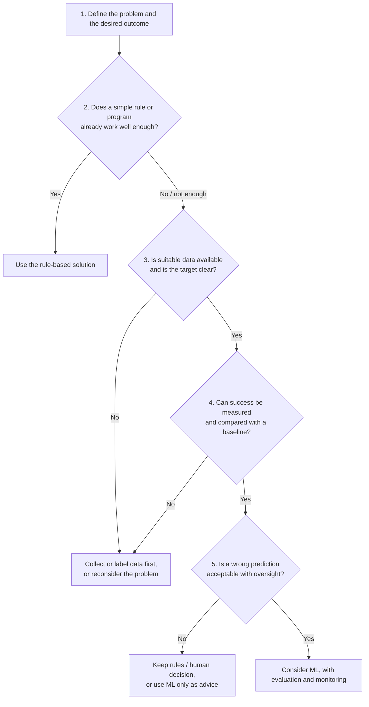

# Mission 8: Does This Problem Actually Need ML?

**Research question:** When should an engineer use ML instead of a fixed rule or conventional program?

## 1. Objective

To learn to start from the problem rather than the technology: define the goal, check whether a simple rule already works, check what data exists, decide how success will be measured, and think about what happens when a prediction is wrong. A rule-based and an ML solution are compared for the same problem.

All data and log lines below are **synthetic** and made up for illustration. No claim is made about any real tool or flow.

## 2. A Checklist Before Choosing ML

| # | Question | Why it matters |
|---|---|---|
| 1 | What exactly is the problem and the desired outcome? | A vague goal cannot be solved by any technique |
| 2 | Does a simple rule or conventional program already do the job well enough? | Rules are simpler, cheaper and predictable |
| 3 | Is suitable data available, and what should the model predict? | ML learns from data; without relevant, trustworthy data it has nothing to learn from |
| 4 | How will success be measured, and against what baseline? | Without a measure and a baseline, "better" cannot be shown |
| 5 | What happens if a prediction is wrong? | Decides how much risk is acceptable and how much human checking is needed |

**Key point:** ML is not automatically the best choice just because a problem involves data. The problem comes first, the technology second.

## 3. The Problem Chosen

**Problem (design verification setting, illustrative):** after a regression run, many tests fail. Engineers must sort each failure into a likely cause category so it can go to the right person, for example *assertion failure*, *timeout*, *data mismatch* or *environment issue*.

**Desired outcome:** each failing test gets a suggested cause category quickly, so engineers spend less time on manual sorting.

**Input:** the text of the failure message or log. **Output:** a category.

## 4. Option A: Rule-Based Solution

Write explicit rules that look for known words or patterns in the failure message.

| Rule | Category |
|---|---|
| message contains "assertion failed" | Assertion failure |
| message contains "timeout" | Timeout |
| message contains "mismatch" | Data mismatch |
| message contains "license" | Environment issue |
| none of the rules match | Unclassified (sent to an engineer) |

### What this looks like on synthetic log lines

| # | Synthetic failure message | Rule result | Correct? |
|---|---|---|---|
| 1 | `ERROR: assertion failed in fifo_ctrl at 1200 ns` | Assertion failure | Yes |
| 2 | `FATAL: simulation timeout after 10 ms` | Timeout | Yes |
| 3 | `ERROR: scoreboard mismatch, expected 0x3F got 0x2F` | Data mismatch | Yes |
| 4 | `ERROR: license server unreachable` | Environment issue | Yes |
| 5 | `Check failed: unexpected response ordering on channel 2` | Unclassified | No rule covers this wording |

Rules work well for messages the team already knows. Line 5 shows the weakness: a new wording has no rule, so someone must write one.

## 5. Option B: Possible ML Solution

Train a text classifier on historical failure messages that engineers already labelled with the right category. After training, it suggests a category for a new message, possibly even when the wording is new but similar to known cases.

This is a **supervised classification** problem (Mission 3 and 4): input = message text, target = category label.

## 6. Comparison: Rule-Based vs ML

| | Rule-based | Possible ML solution |
|---|---|---|
| **How it decides** | Explicit rules written by people | Patterns learned from labelled examples |
| **Data needed** | None to start; knowledge of the common messages | A good number of correctly labelled historical failures, covering all categories |
| **Setup effort** | Low; quick to build | Higher: collect and clean data, label it, train, evaluate |
| **Handles new wording** | Poorly; needs a new rule each time | Possibly, if similar to training examples, but not guaranteed |
| **Predictability** | High; you can see exactly why a message got a category | Lower; harder to explain why a category was chosen |
| **Maintenance** | Keep adding and fixing rules as messages change | Keep retraining and checking as logs and tools change |
| **Cost of a miss** | Unmatched failures are visibly "Unclassified" and go to a person | A wrong category may look confident and be missed silently |
| **How success is measured** | Share of failures classified correctly; share left unclassified | Same measures, plus recall on important or rare categories, compared with the rule baseline |

### Failure modes

**Rule-based failure modes**
- A new or reworded message matches no rule (coverage gap).
- A message matches the *wrong* rule (for example, a message containing both "timeout" and "mismatch").
- The rule list grows large and hard to maintain.

**ML failure modes**
- Too little or unrepresentative data, so rare categories are poorly learned.
- Inconsistent or wrong labels teach wrong categories.
- A rare but important category is under-detected while accuracy still looks high (Mission 6).
- Log formats or tools change over time, so performance slowly drops (Mission 7, drift).
- Wrong predictions delivered with false confidence, so a real bug may be dismissed as "environment issue".

## 7. When a Rule Is Clearly Enough

Take a different problem: "Did the simulation finish successfully?" If the tool returns an exit code (0 for success), a one-line rule answers it exactly. There is no uncertainty, no pattern to learn, and ML would only add data work and the chance of error. This is a good example of why the question "does a simple rule already work?" comes before "can ML do it?".

## 8. Applying the Checklist to the Chosen Problem

| # | Question | Assessment |
|---|---|---|
| 1 | Problem and outcome | Clear: sort failures into cause categories faster |
| 2 | Does a simple rule work? | Mostly yes for known messages. **Measure how many failures end up "Unclassified"** before deciding anything else |
| 3 | Data available? | Only if past failures were labelled consistently. This must be checked, not assumed |
| 4 | Measuring success | Compare against the rule-based baseline: correct share, unclassified share, recall on important categories, engineer time saved |
| 5 | If wrong? | A misrouted failure wastes time; a real bug labelled harmless could be missed, so keep human review, especially for low-confidence cases |

**My conclusion (a judgement, not a proven result):** start with the rule-based solution, because it is simple and predictable. If measurement shows many failures stay unclassified, *and* enough consistently labelled history exists, an ML classifier could be considered as an addition. One possible design is rules first, with ML suggestions only for the unmatched cases and an engineer reviewing them. If the data is not there, ML should not be started yet.

## 9. What Is Still Unclear

- How much labelled data would be "enough" to train a dependable classifier for this problem.
- How to measure honestly whether the ML addition beats the rules once their maintenance cost is included.
- How to show an engineer *why* a category was suggested.

## 10. Conclusion

Choosing ML should come from the problem, not from enthusiasm for the technology. A simple rule is often enough, easier to trust and cheaper to maintain. ML becomes attractive when rules cannot keep up, suitable labelled data exists, success can be measured against the rule baseline, and wrong predictions can be caught by human oversight. Both approaches have failure modes, so whichever is chosen must be evaluated and monitored.

## 11. Sources

Sources for this mission will be added to [`sources.md`](sources.md).
