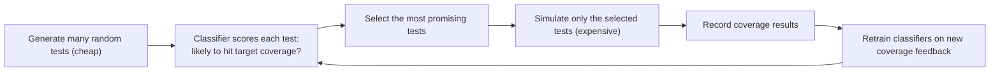

# Mission 9: Semiconductor Case Study - ML for Test Selection in Design Verification

**Area chosen:** Design Verification (DV)
**Application:** Using supervised learning on coverage feedback to choose which simulation tests to run (called *coverage-directed test selection*)

## 1. The Engineering Problem

In simulation-based verification, a design is stressed with test stimuli and its behaviour is checked against the specification. Progress is tracked with **functional coverage**, and a logical piece of functionality that has not yet been exercised is a **coverage hole**. Most tests are generated by constrained random generation. As verification progresses, many of these tests repeat the same logic and add little new coverage, while writing constraints to reach the remaining holes is slow, manual work done by experienced engineers (Source 1).

Simulation is expensive. For the design studied in the paper, reaching full functional coverage needs roughly 2 million constrained random tests, at about 2 hours per test (Source 1). So choosing *which* tests to simulate matters.

## 2. The Idea

Generate a large pool of random tests cheaply, then use a trained model to **pick the subset most likely to hit uncovered coverage**, and simulate only those (Source 1).

## 3. Data Needed

| Item | What the paper used (Source 1) |
|---|---|
| Design | An industrial radar signal processing block (Infineon RSPU, AURIX TC3XX family) |
| Inputs (features) | Each test is a vector of 300 configuration fields |
| Coverage model | About 200 coverage groups and about 6,000 cross-product coverage points |
| Labels | Tests that exercised a target coverage group are positive examples; a sample of tests that did not are negative examples |
| Dataset | A database of 86,000 already-simulated tests (about 3,000 "golden" regression tests plus 83,000 constrained random ones), used to emulate simulation |

**Data challenge:** the coverage holes have never been hit, so there are no positive examples for them. The authors address this by training on *coverage groups* (similar coverage points grouped using the verification plan) so that positive examples exist.

## 4. Model Output, Task Type and Learning Approach

- **Output:** for each new test, a prediction of whether it will exercise a target coverage group. Tests predicted negative are not selected for simulation.
- **Task type:** **binary classification** (Mission 4).
- **Learning approach:** **supervised learning** (Mission 3), trained on labelled coverage feedback. The paper compares several classifiers (decision trees, random forest, gradient boosting, logistic regression, Naive Bayes and a neural network).
- A classifier is trained for each target coverage group and retrained every iteration (under 5 minutes each time). The method is switched on once about 90% coverage is reached, since early on random tests still add coverage quickly.

## 5. How Results Were Evaluated

The metric matches the engineering goal: the **number of tests needed to reach 95%, 98% and 99% functional coverage**, compared with random selection (similar to ordinary constrained random testing) and with a "dummy" baseline that predicts at random (Source 1). This is a task-specific metric, not plain accuracy (Mission 6).

| Method (at 99% coverage) | Tests needed | Saving vs random |
|---|---:|---:|
| Random selection | 44,200 | n/a |
| Logistic regression | 42,667 | 3.47% |
| Neural network | 37,919 | 14.21% |
| Naive Bayes | 35,960 | 18.64% |

Gradient boosting was the best of the tree-based methods, cutting the tests needed for 99% coverage by almost 11% (Source 1). Overall the authors report that this coverage model could be nearly closed by simulating about 18% fewer tests.

## 6. Limitations Engineers Must Investigate

These come from the paper unless marked as my own reasoning.

1. **Not live simulation.** Experiments used a database of pre-simulated tests to emulate simulation, because running real simulation was impractical.
2. **One design.** Results are for a single block; they may not carry over to other designs.
3. **Diminishing returns.** Beyond 99% coverage, the method was not significantly better than constrained random testing for this model, with roughly 60 coverage points left.
4. **Coverage is only an approximation.** The authors note a coverage model is somewhat subjective and bugs can hide outside it, so hitting coverage faster does not prove the design is bug-free.
5. **Trade-offs between models.** Non-tree models saved more tests but are less transparent to engineers and slower to train (the neural network took 5 days versus 1 day for a standard decision tree).
6. **Overfitting.** Untuned decision trees gave inconsistent results, which the authors link to overfitting; limiting tree depth helped.
7. **Noisy, imperfect separation** between positive and negative training data.
8. *My own reasoning:* a model trained on one project's tests may need re-checking when the design or test setup changes (data drift, Mission 7), and its picks should still be reviewed by engineers.

## 7. What Is Deployed, What Is Research, What Is a Proposal

| Claim | Status | Basis |
|---|---|---|
| Coverage-directed test selection works on the studied RSPU data | **Research demonstration** on data from an industrial design, in a pre-simulated experiment | Source 1 |
| Saving about 18% of tests (roughly 1.7 million instead of 2 million in production) | **Projection / proposal**, since the authors say "this could mean" scaling to production | Source 1, conclusion |
| Earlier coverage-directed test generation using Bayesian networks | **Earlier research method**; the 2003 paper presents it as a new approach, and Source 1 notes it needed a lot of encoded domain knowledge | Source 2, Source 1 |
| That this exact method is used in a production flow | **Not established by these sources.** I make no deployment claim | n/a |

## 8. Conclusion

Coverage-directed test selection is a clear example of the ML foundations from this week: a defined engineering problem (reach coverage with fewer expensive simulations), tabular labelled data built from coverage feedback, a supervised binary-classification task, evaluation against random and dummy baselines with a metric that matches the goal, and honest limitations. The evidence supports it as a promising research result, not as proof of a deployed tool, and its predictions remain advice for verification engineers to review.

## 9. Sources

1. **Primary:** N. Masamba, K. Eder, T. Blackmore, "Supervised Learning for Coverage-Directed Test Selection in Simulation-Based Verification" (University of Bristol and Infineon Technologies), arXiv preprint 2205.08524, 2022. https://arxiv.org/pdf/2205.08524
2. **Primary (earlier method):** S. Fine, A. Ziv, "Coverage directed test generation for functional verification using Bayesian networks," Proceedings of the 40th Design Automation Conference (DAC '03), 2003. https://dl.acm.org/doi/10.1145/775832.775907
3. **Secondary (review):** "Coverage-Directed Test Generation Automated by Machine Learning - A Review." https://www.researchgate.net/publication/220306081_Coverage-Directed_Test_Generation_Automated_by_Machine_Learning_-_A_Review

Claim-by-claim mapping will be in [`sources.md`](sources.md).
