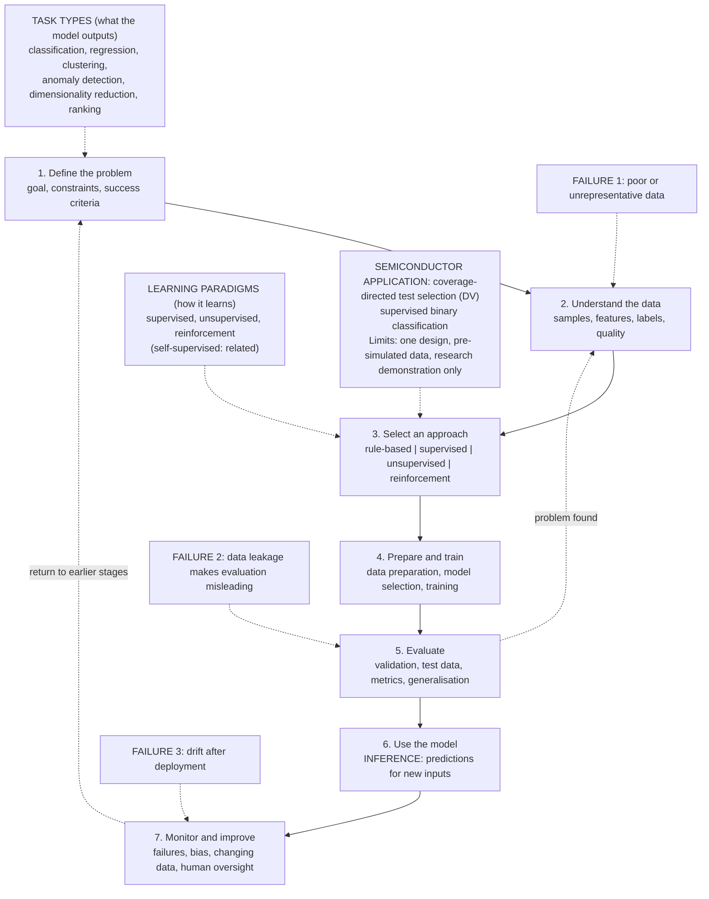

# ML Foundations Map (Lifecycle)

## How to read the map

- **Paradigms vs task types.** Task types describe what the model must output, so they are chosen when the problem is defined. Learning paradigms describe how it learns, so they are chosen when selecting the approach. They are different levels and must not be mixed up.
- **Where things happen.** Data preparation and training happen in stage 4, evaluation in stage 5, and inference in stage 6.
- **Three failure points.** (1) Poor or unrepresentative data enters at stage 2. (2) Data leakage makes the stage 5 evaluation look better than it is. (3) Drift appears after deployment, at stage 7.
- **Semiconductor application.** Coverage-directed test selection (Mission 9) is supervised binary classification. Its limits are that it was tested on one design, used pre-simulated data, and is a research demonstration, not a proven deployed tool.
- **Not a straight line.** Real projects loop back to earlier stages when evaluation or monitoring uncovers a problem.
