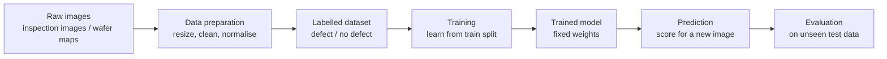

# Mission 1 – Data Behind Deep Learning

**Question:** Before a neural network can learn, what must happen to its data?

## Flow diagram

| Stage | What happens |
|---|---|
| Raw images | Images come from inspection or test equipment. They differ in size, brightness and quality. |
| Data preparation | Images are resized to one input size, bad or duplicate files are removed, and values are normalised. |
| Labelled dataset | Each image gets a label from engineers. The dataset is split into training, validation and test sets. |
| Training | The network adjusts its weights to reduce its error on the training examples. |
| Trained model | The weights are now fixed and can be used on new images. |
| Prediction | A new image goes in and a defect score comes out. |
| Evaluation | The model is scored on test data it never saw, to estimate how it will behave in practice. |

## Research topics
**1. From raw data to model input.** An image is a grid of pixels, and each pixel is a number
(for example 0-255 for brightness in a grayscale image; colour images have three numbers per pixel).
The network receives these numbers, either as a flat list or as a 2-D grid.

**2. Data preparation.** Images are resized so every sample has the same shape. Corrupted or duplicate files
are cleaned out. Normalisation means rescaling values to a common range (for example 0 to 1) so that no
input dominates and training is more stable.

**3. Labels and examples.** The image is the input and the label is the correct answer for it
("defect" / "no defect"). A team would write clear labelling rules, have trained engineers label the images,
have a second person review disagreements, and confirm doubtful cases using failure analysis where possible.

**4. Data quality.** Wrong labels teach the model wrong patterns. Duplicate images, especially across train and
test sets, make test scores look better than they really are. Noisy images make patterns harder to learn,
and missing example types mean the model never learns them.

**5. Representativeness and imbalance.** If one defect type has thousands of examples and another has a handful,
the model gets good at the common one and may miss the rare one. Overall accuracy can hide this, so results
should be checked per class.

**6. Data splitting.** The training set updates the weights, the validation set guides decisions such as model
size, and the test set is a final check. If the test set is used again and again to make decisions, the model
slowly fits it and the test score stops being trustworthy. Google's course calls this the validation and test
sets "wearing out".

## Two data problems that could affect the final prediction
1. **Incorrect labels:** if some defective images are labelled "no defect", the model learns to ignore real
   defect patterns, and it will also be judged against wrong answers.
2. **Class imbalance:** if rare defect types have very few examples, the model may predict "no defect" or the
   common defect type for them, and these misses could look fine in the overall accuracy.
