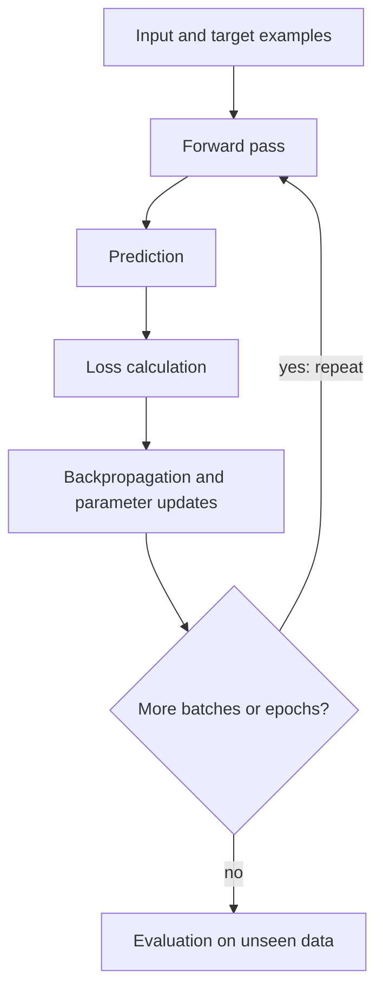

# Mission 4 – How Does a Neural Network Learn?

## Flowchart

## The process in plain words
The network starts with random weights, so its first predictions are poor. In the **forward pass** it takes an
input image, passes the numbers through its layers using its current weights and biases, and produces a
**prediction**. The **loss function** compares the prediction with the correct label and gives one number: small if the
prediction is close, large if it is far off (and especially large if the model was confidently wrong).
**Backpropagation** works backwards from the loss and works out how much each weight contributed to the error.
**Optimisation** (gradient descent) then nudges each weight a small step in the direction that reduces the loss.
Google's course describes backpropagation as the most common training algorithm for neural networks, which makes
gradient descent practical for multi-layer networks. One **epoch** means the model has seen every training example
once. Training repeats over many epochs. At the end, the model is checked on **unseen data** to see whether it learned patterns that
transfer.

## Topics
- **Forward pass:** current parameters turn the input into a prediction.
- **Loss:** measures how wrong the prediction is. Training tries to make it small.
- **Optimisation:** small parameter updates that reduce the loss.
- **Backpropagation:** finds how each parameter should change to reduce the error.
- **Epoch:** one full pass through the training set.
- **Training vs inference:** in training, parameters change. In inference the trained, fixed model is just used to predict.
- **Generalisation:** checked by evaluating on validation/test data the model never trained on, and by comparing
  training and validation loss.

## Applying it to the inspection scenario
If the model misclassifies several images at the start, their loss is high. Backpropagation traces that error back
through the layers, and the weights are updated so that similar images get a better score next time. After many
epochs the model is evaluated on held-out images, using metrics per defect type and not just overall accuracy.

**Situation 1: incorrect training labels.** The model is being taught wrong answers. It may learn a wrong pattern or
memorise the noisy labels, and its loss can look good while it is learning the wrong thing. If the test labels are wrong
too, the evaluation is misleading. This shows that a model can only be as good as its labels, and that the
evaluation data must be checked as carefully as the training data.

**Situation 2: very good on training data, poor on new images.** This is overfitting. The model memorised training
examples instead of learning general patterns. It tells me that training performance alone proves nothing, and
that evaluation must use unseen data. Possible responses include more varied data, a simpler model, regularisation
(for example dropout) and stopping training earlier.
