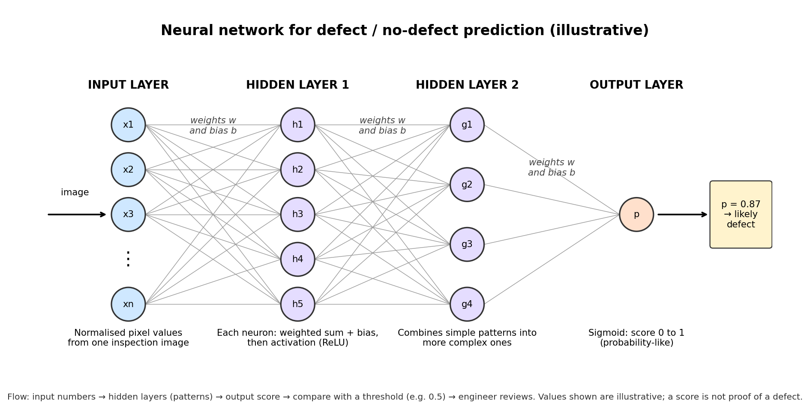

# Mission 3 – Open the Neural Network

*Illustrative network for a defect / no-defect decision. The numbers shown are examples, not real results.*

## Components
- **Input layer:** receives the numbers describing the example (here, pixel values from one image). It does no
  learning of its own; it just passes the numbers in.
- **Hidden layers:** the layers between input and output. They combine the numbers in learned ways, so early
  layers pick up simple patterns and later layers combine them into more complex ones.
- **Output layer:** gives the final result. For defect / no defect it gives one score between 0 and 1.
- **Neurons (nodes):** small units that take numbers in, do a simple calculation and pass a number on.
- **Weights and biases:** a weight says how strongly one input affects a neuron; a bias shifts the neuron's result.
  These are the numbers that training adjusts.
- **Activation functions:** a step after each neuron's calculation that lets the network learn non-straight-line
  patterns. Without them, stacked layers would behave like one simple linear model. ReLU is common in hidden layers,
  and sigmoid squeezes the output to a 0-1 score.

## Tracing one example (semiconductor inspection)
1. **What enters:** an inspection image is resized and normalised, so every pixel becomes a number between 0 and 1.
   These numbers are the input layer.
2. **Hidden layer 1:** each neuron multiplies the inputs by its weights, adds its bias, and applies ReLU. Some neurons
   respond to patterns such as a bright line or a cluster of dark spots.
3. **Hidden layer 2:** these neurons combine the earlier patterns into larger ones, such as "a scratch-like shape near
   the edge".
4. **Output:** the final neuron applies a sigmoid and gives a score, for example 0.87. This means "the model is fairly
   confident this looks like the defect images it was trained on".

## Why the prediction is not proof of a defect
The score is a learned estimate, not a measurement. The network may have learned patterns that only correlate with
defects (lighting, dust, image artefacts), the training labels may contain mistakes, the image may show a defect type
it never saw, and the 0.5 threshold is a choice that trades missed defects against false alarms. An engineer must
confirm the result before it drives a decision.
