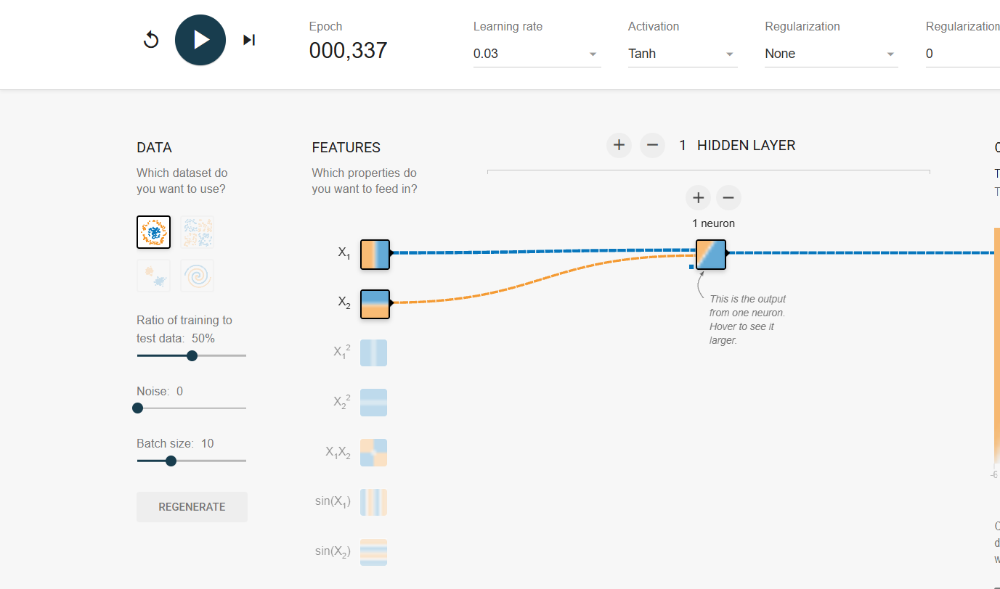
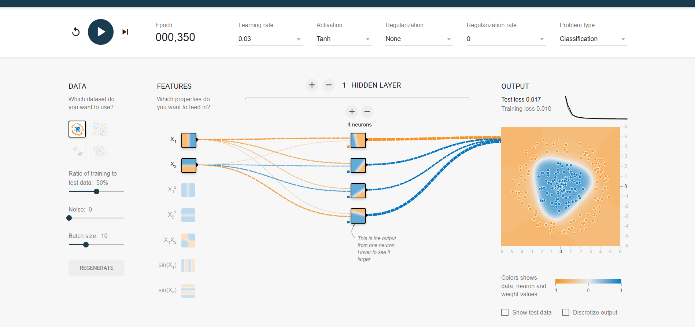
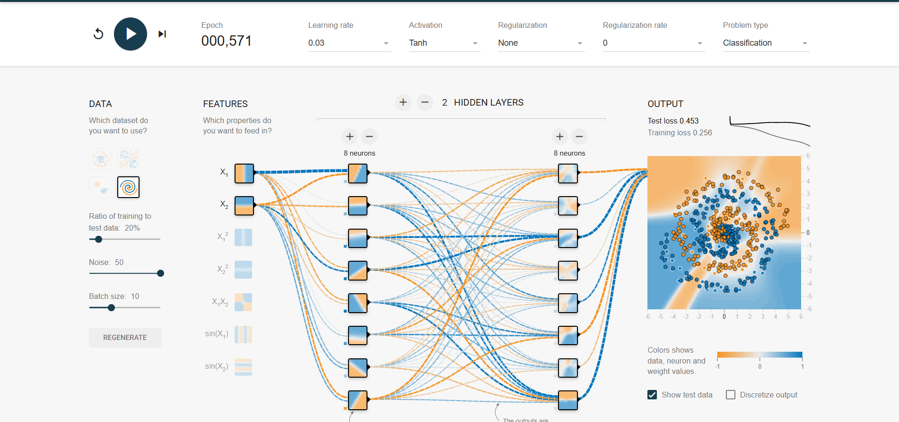
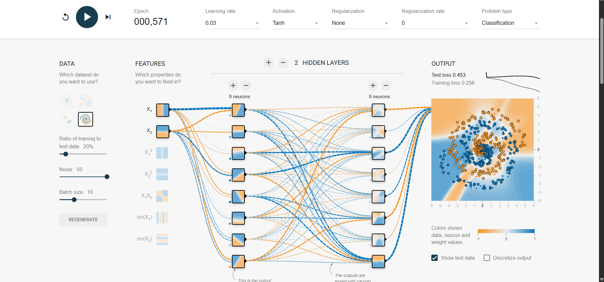

# Mission 5 – Experiment and Observe

Tool: TensorFlow Neural Network Playground (https://playground.tensorflow.org/)
Common settings: Tanh activation, learning rate 0.03, no regularization, batch size 10, features X1 and X2 only.

## Settings and results
| | Run 1 (basic) | Run 2 (more complex) | Run 3 (complex + noisy + little data) |
|---|---|---|---|
| Dataset | Circle | Circle | Spiral |
| Hidden layers / neurons | 1 layer, 1 neuron | 1 layer, 4 neurons | 2 layers, 8 + 8 neurons |
| Noise | 0 | 0 | 50 |
| Train / test ratio | 50% | 50% | 20% |
| Epochs run | 337 | 350 | 571 |
| Training loss | 0.370 | 0.010 | 0.256 |
| Test loss | 0.422 | 0.017 | 0.453 |
| Decision boundary | One straight diagonal line; cannot separate the circle from the ring, so many orange points fall on the blue side | A rounded shape around the blue centre; separates the blue circle from the orange ring | Patchy, irregular regions that do not follow a clean spiral; with test data shown, many test points fall in a region of the opposite colour, especially near the centre where the spiral arms overlap |
| Screenshot | screenshots/run1.png | screenshots/run2.png | screenshots/run3.png, screenshots/run3_settings.png |

## Screenshots and what they show
**Run 1** – `screenshots/run1.png`

One hidden neuron after 337 epochs. The loss curve has flattened, and the output shows a single straight diagonal boundary.
The blue circle and orange ring cannot be separated by one line, so many orange points sit in the blue area.

**Run 2** – `screenshots/run2.png`

Four hidden neurons after 350 epochs. The output shows a rounded blue region around the centre with the orange ring outside it.
Both losses are very low (0.010 training, 0.017 test), and the two values are close to each other.

**Run 3** – `screenshots/run3.png` and `screenshots/run3_settings.png`

Spiral data with noise 50, only 20% of the data used for training, and two hidden layers of 8 neurons after 571 epochs. The
second image shows the settings and the epoch. In the first image "Show test data" is ticked, and many test points lie
in the wrong colour region. The coloured regions are patchy and do not form a clean spiral. The training loss (0.256) is lower
than the test loss (0.453).

## Observations and conclusions
- **What changed when I modified the network?** Going from 1 neuron (Run 1) to 4 neurons (Run 2) on the same circle
  data changed the boundary from a straight line to a closed curved shape. Test loss dropped from 0.422 to 0.017, and
  training loss from 0.370 to 0.010. One neuron can only draw one straight boundary, and a few neurons can combine
  several to wrap around the circle.
- **Did the more complex network always perform better?** No. Run 3 used the biggest network (2 x 8 neurons), but the
  data was noisy and only 20% of it was used for training. Its test loss (0.453) was clearly higher than its training
  loss (0.256), and the boundary was irregular. This is consistent with overfitting: the model fits the few noisy
  training points more than the real pattern. With "Show test data" ticked, many unseen test points lie in the wrong
  colour region, which matches the higher test loss.
- **Complexity and learnable patterns:** more neurons and layers allow more complicated boundaries, which is what
  solved the circle in Run 2. But the same freedom lets the network bend around noise when data is limited, as in Run 3.
- **Why training performance is not enough:** in Run 3 the training loss alone (0.256) looks better than the test loss
  (0.453). The test loss is the more honest estimate of how the model behaves on new data.
- **How this differs from real semiconductor inspection images:** the Playground uses two input features, a few hundred
  2-D points, clean synthetic shapes and training that takes seconds. Real images have thousands of pixel inputs,
  ambiguous or wrong labels, rare defect types and changing conditions, and mistakes can be costly.
- **Evidence needed before claiming a model is suitable:** results on a separate unseen test set (ideally from a later
  time period), per-class precision and recall, a confusion matrix, checks of label quality, review of failure cases by
  engineers, and a comparison with a simple baseline.

## Limits of my experiment
Run 3 changed several things at once (dataset, noise, training ratio and network size), so it does not isolate the effect
of complexity alone. It shows the training/test gap, but a cleaner test would keep the data fixed and change only the network
size. I also ran each configuration once, and Playground results vary with the random starting weights.

**Conclusion:** Adding neurons let the network solve a problem that a single neuron could not (test loss 0.422 → 0.017), but
in Run 3 a large network on noisy, limited data had a clear gap between training loss (0.256) and test loss (0.453). More
complexity helps only when the data and the problem support it, and training loss alone is not proof of a good model.
